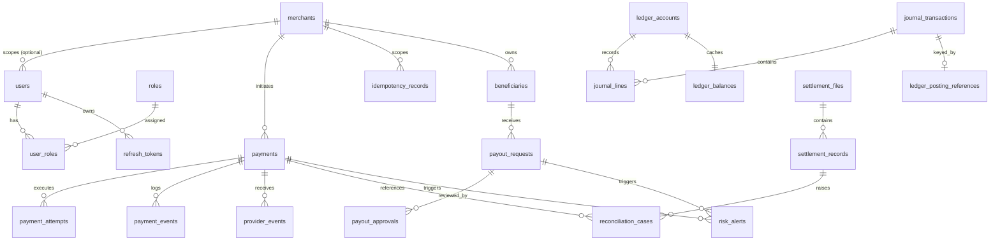

# PayShield — Database Design & Financial Invariants

PostgreSQL is the single source of truth for all transactional, ledger, audit, and operational state. Schema evolution is managed strictly via Flyway migrations (`backend/src/main/resources/db/migration/`). All timestamps use `TIMESTAMPTZ` in UTC. Monetary values use `BIGINT` in minor units (e.g., INR paise).

---

## 1. Entity-Relationship Overview

---

## 2. Core Tables & Constraints

| Domain | Tables | Key Financial / Security Invariants |
|---|---|---|
| **Auth & Merchants** | `merchants`, `users`, `roles`, `user_roles`, `refresh_tokens` | Unique `email`, BCrypt password hash, hashed refresh tokens, merchant isolation FK |
| **Payments** | `payments`, `payment_attempts`, `payment_events`, `idempotency_records`, `provider_configs` | `amount_minor > 0`, ISO-4217 `currency` (`CHAR(3)`), `UNIQUE (merchant_id, idempotency_key)` |
| **Webhooks & Outbox** | `provider_events`, `outbox_events`, `inbox_events` | `UNIQUE (provider_code, provider_event_id)` for inbox/webhook deduplication |
| **Ledger** | `ledger_accounts`, `journal_transactions`, `journal_lines`, `ledger_balances`, `ledger_posting_references` | `amount_minor > 0`, `entry_type IN ('DEBIT','CREDIT')`, `UNIQUE (source_type, source_id, posting_type)`, balanced debits/credits |
| **Reconciliation** | `settlement_files`, `settlement_records`, `reconciliation_cases` | `UNIQUE (file_sha256)` prevents duplicate file ingestion |
| **Payouts** | `beneficiaries`, `payout_requests`, `payout_approvals`, `payout_kill_switch` | `amount_minor > 0`, `CHECK (maker_user_id <> checker_user_id)` on approval |
| **Risk & Audit** | `risk_rules`, `risk_alerts`, `audit_events` | Append-only `audit_events`, explainable `rule_code` + `explanation` on `risk_alerts` |
