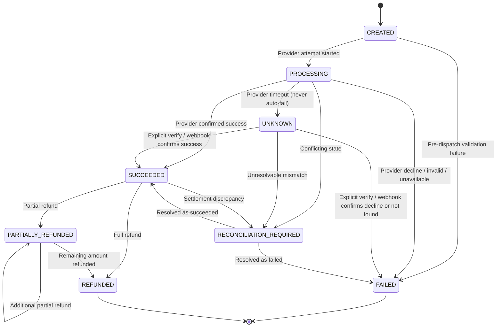
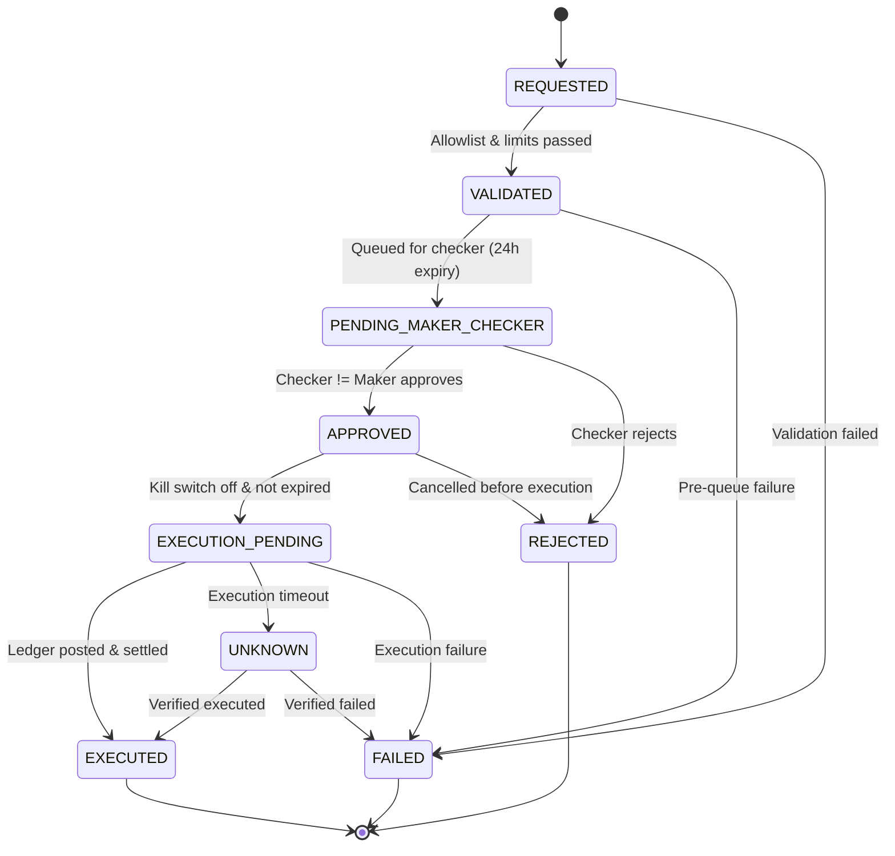

# PayShield — Payment & Payout Lifecycle State Machines

## 1. Payment Lifecycle State Machine

### Uncertainty Safety Rule
A provider timeout (`TIMEOUT_AFTER_PROCESSING` or `TIMEOUT_BEFORE_PROCESSING`) **must** transition the payment to `UNKNOWN` and never to `FAILED`. Automated failover to a secondary provider is prohibited while a payment is in `UNKNOWN` or `PROCESSING` without first calling `verifyStatus` on the original provider request ID.

---

## 2. Payout Lifecycle State Machine

