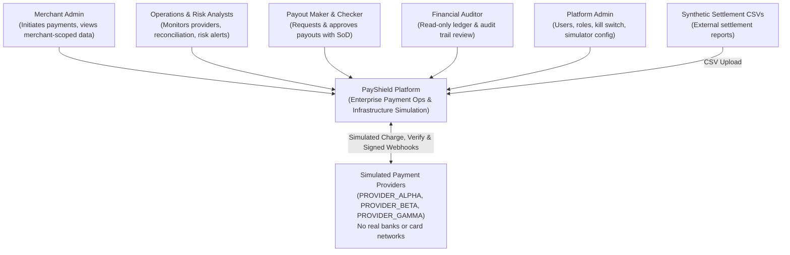
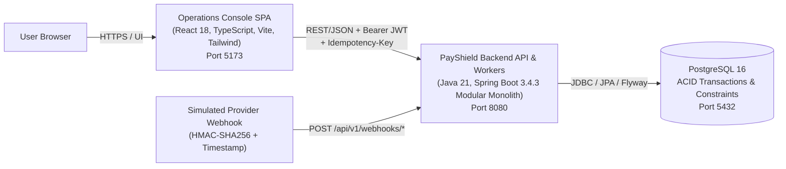
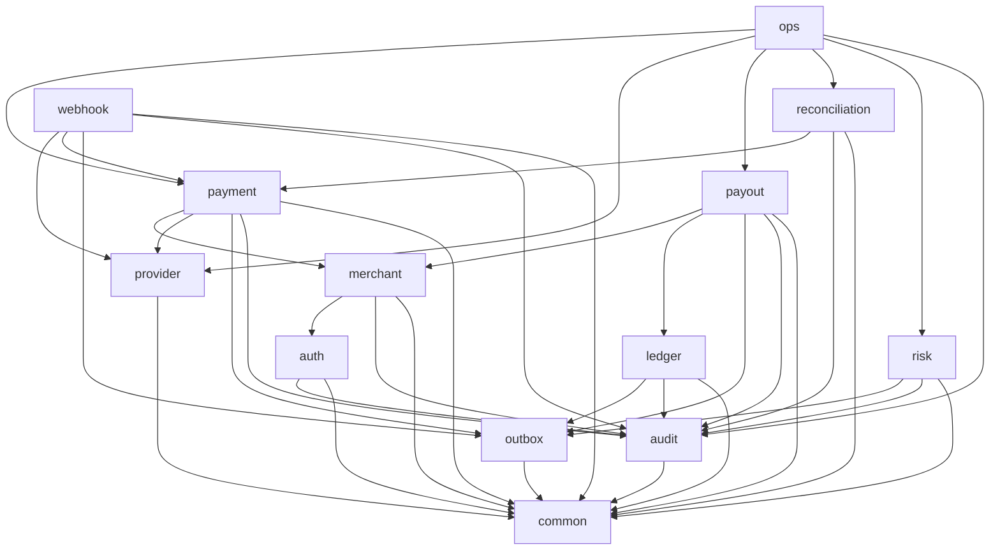
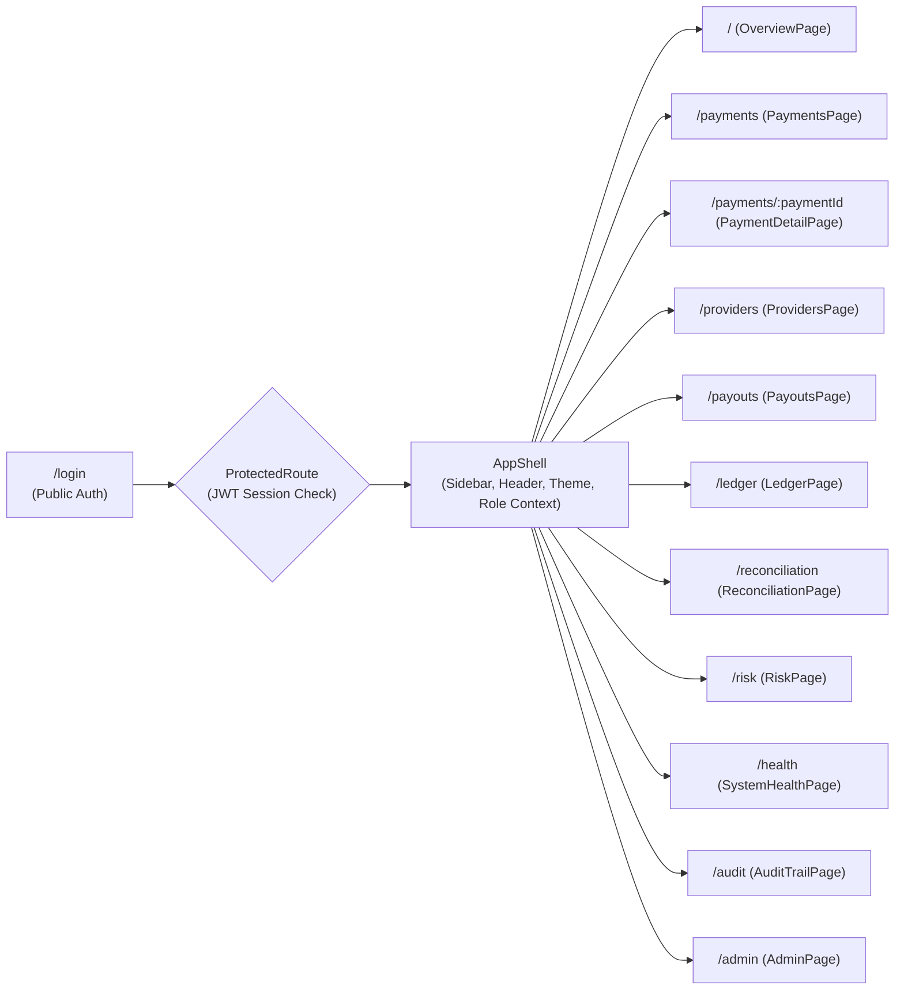

# PayShield — System Architecture Overview (C4, Modules & Risks)

## 1. C4 Context Architecture

---

## 2. C4 Container Architecture

---

## 3. Backend Module Dependency Diagram

Strict unidirectional DAG enforced by ArchUnit (`ArchitectureRulesTest`):

---

## 4. Frontend Route Architecture

---

## 5. Highest-Risk Architectural Decisions & Verification Strategy

| Risk Area | Architectural Decision | How It Will Be Tested |
|---|---|---|
| **Duplicate Payments Under Concurrency** | Scoped `UNIQUE (merchant_id, idempotency_key)` + SHA-256 request payload hash verification | Multi-threaded concurrency test (`concurrentIdempotentRequestsProduceSinglePayment`) + k6 `concurrent_idempotency` profile |
| **False Failures on Provider Timeouts** | Timeouts transition to `UNKNOWN` (never `FAILED`); requires explicit provider `verifyStatus` before resolution | Integration test with `TIMEOUT_AFTER_PROCESSING` -> `UNKNOWN` -> `/verify` -> `SUCCEEDED` |
| **Duplicate Webhook Financial Effects** | Constant-time HMAC-SHA256 + 300s replay window + `provider_events` & `inbox_events` deduplication | Integration test sending invalid signature (401), valid webhook (`PROCESSED`), and duplicate (`DUPLICATE`) |
| **Unbalanced or Mutated Ledger** | Integer minor units (`long`), `SUM(DEBIT) == SUM(CREDIT)` check, `ledger_posting_references` uniqueness, reversal-only corrections | Unit/integration tests for unbalanced rejection, duplicate posting idempotency, reversal creation, and `FINANCIAL_AUDITOR` write block (403) |
| **Payout Self-Approval & Bypass** | Service check + DB `CHECK (maker_user_id <> checker_user_id)` + `APPROVED` & kill-switch gate on execution | Integration tests verifying maker self-approval returns 403, unapproved execution returns 409, and kill switch returns 503 |
