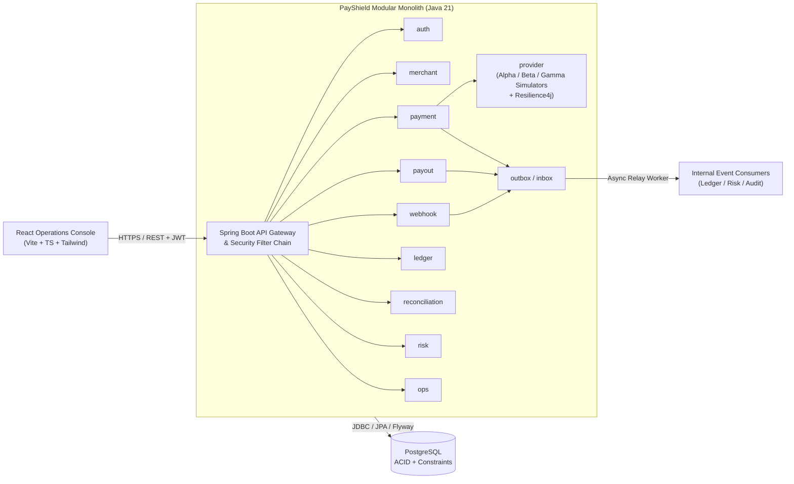
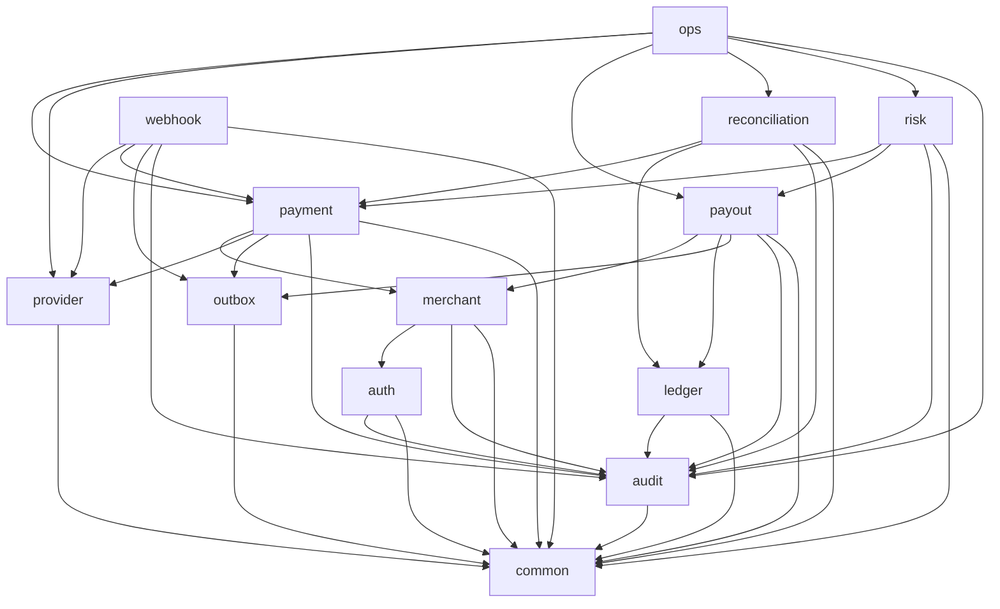

# PayShield — System Architecture Overview

## 1. Architectural Style
PayShield is structured as a **modular monolith** in Java 21 / Spring Boot 3.4 paired with a **React + TypeScript** Operations Console and **PostgreSQL** as the system of record.

A modular monolith was chosen over microservices so that critical financial invariants—such as persisting a payment state change alongside its `outbox_events` row, or posting a balanced double-entry `journal_transaction`—execute within a single ACID database transaction without distributed two-phase commit complexity.

---

## 2. High-Level System Diagram

---

## 3. Backend Module Dependency Diagram

---

## 4. Key Engineering Patterns
1. **Idempotency-First Writes**: Payment creation uses a unique `(merchant_id, idempotency_key)` record with request-hash verification to prevent duplicate charges under retries or concurrency.
2. **Uncertainty-Safe Orchestration**: Provider timeouts transition payments to `UNKNOWN` rather than `FAILED`, requiring explicit provider status verification before any retry or reconciliation decision.
3. **Transactional Outbox & Inbox**: State transitions and outbox events commit atomically in PostgreSQL. Webhook and event consumers use `inbox_events` deduplication for idempotent processing.
4. **Double-Entry Bookkeeping**: All money movement posts immutable, balanced journal transactions (`SUM(DEBIT) == SUM(CREDIT)`).
5. **Maker-Checker Payout Governance**: Separation of duties is enforced in both application services and PostgreSQL `CHECK` constraints (`maker_user_id <> checker_user_id`).
